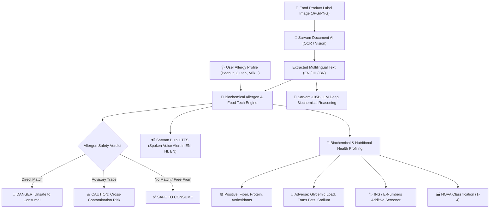

# 🛡️ AI Allergen Detector

> **Next-Generation Multilingual Food Safety & Biochemical Health Analyzer**  
> *Developed for Food Technology & Biochemical Engineering Applications*  
> *Powered by Sarvam AI (Indic Document AI, Chat-105B, Bulbul TTS, Indic Translate)*

---

## 📌 Project Overview

In India, packaged foods increasingly feature ingredients and allergen warnings in diverse regional languages (**English, हिन्दी, and বাংলা**). For individuals with food allergies (such as Celiac disease, Cow's Milk Protein Allergy, or severe Peanut anaphylaxis), reading small-print multilingual packaging is critical and often life-saving.

**AI Allergen Detector** is an end-to-end intelligent safety system that allows consumers to:
1. **Upload or capture a photo** of any packaged food product label (in English, Hindi, or Bengali).
2. **Specify personal sensitivities or allergies** (e.g., Peanuts, Gluten/Wheat, Milk/Dairy, Soy, Tree Nuts, Mustard, Sesame, etc.).
3. **Receive an instant, high-visibility Safety Verdict**:
   - 🚨 **UNSAFE / DANGER**: Immediate alert preventing consumption if target allergens are present as direct ingredients.
   - ⚠️ **CAUTION**: Warning when cross-contamination or shared facility advisory traces are discovered.
   - ✅ **SAFE**: Verified clean label with no matching allergens found.
4. **Hear Spoken Audio Alerts in Indian Accents**:
   - Powered by **Sarvam Bulbul TTS (`bulbul:v4-flash`)**, pronouncing safety warnings aloud in **English (`en-IN`)**, **Hindi (`hi-IN`)**, or **Bengali (`bn-IN`)**.
5. **Get Food Science & Biochemical Health Profiling**:
   - **Positive Biochemical Aspects**: Dietary fiber ($\beta$-glucan, cellulose), bioavailable essential amino acids, polyphenolic antioxidant activity.
   - **Adverse Biochemical Effects**: High Glycemic Index free sugars (invert syrup, liquid glucose triggering rapid de novo lipogenesis), atherogenic trans/saturated fatty acid profiles, and sodium-induced osmotic stress.
   - **Food Additives & INS Screener**: Automatically identifies INS / E-numbers (e.g., INS 102, INS 211, INS 322, INS 471, INS 621, INS 955) and explains their physiological impacts.
   - **NOVA Classification (1 to 4)**: Evaluates industrial food processing degrees (from minimally processed to Ultra-Processed Foods / UPF).

---

## 🏗️ System Architecture



---

## 🔬 Food Technology & Biochemical Engineering Core

### 1. Major Allergenic Protein Families Covered
- **Peanuts / Groundnuts (*Arachis hypogaea*)**: Ara h 1, Ara h 2, Ara h 3, Ara h 6 (heat-resistant 2S albumins and cupin seed storage proteins).
- **Gluten & Wheat**: $\alpha/\beta/\gamma/\omega$-gliadins and glutenins triggering Celiac enteropathy (HLA-DQ2/DQ8) and WDEIA (Wheat-Dependent Exercise-Induced Anaphylaxis).
- **Milk & Dairy**: Bos d 4 ($\alpha$-lactalbumin), Bos d 5 ($\beta$-lactoglobulin), Bos d 8 (caseins $\alpha/\beta/\kappa$). Distinguishes immune CMPA from non-immune Lactose Intolerance.
- **Tree Nuts**: Ana o 1–3 (Cashew), Pru du 6 (Almond), Jug r 1–2 (Walnut), Pis v 1–3 (Pistachio).
- **Soy**: Gly m 5 ($\beta$-conglycinin) and Gly m 6 (glycinin 11S globulin), plus emulsifier carrier INS 322 (Soy Lecithin).
- **Mustard & Sesame**: Sin a 1 / Bra j 1 (2S albumins prevalent in Indian cooking) and Ses i 1–7 (Til).
- **Sulfites**: Non-protein inorganic ion ($SO_2 / HSO_3^-$) triggering neurogenic reflex bronchoconstriction in asthmatics.

### 2. Food Additive INS / E-Number Database
- **INS 102 (Tartrazine) & INS 110 (Sunset Yellow)**: Synthetic azo colorants linked to histamine release and hyperactivity.
- **INS 211 (Sodium Benzoate)**: Preservative that can decarboxylate into benzene in the presence of ascorbic acid (Vitamin C).
- **INS 322 (Lecithin)**: Phospholipid emulsifier; allergen warning if derived from unrefined soy or egg.
- **INS 471 (Mono- and Diglycerides)**: Emulsifier; linked in nutritional studies to gut mucosal thinning and microbiota alteration.
- **INS 621 (Monosodium Glutamate / MSG)**: L-glutamate salt acting on T1R1/T1R3 umami receptors.
- **INS 951 (Aspartame) & INS 955 (Sucralose)**: High-intensity sweeteners; aspartame is strictly contraindicated in Phenylketonuria (PKU).

---

## 🚀 Getting Started

### 1. Requirements
- Python 3.10+ (tested and compatible with Python 3.14)
- Pip

### 2. Setup & Installation
Clone or navigate to the project directory:
```bash
cd "C:\Users\Soham Das\.gemini\antigravity\scratch\ai-allergen-detector"
```

Install the dependencies:
```bash
pip install streamlit sarvamai requests pillow python-dotenv
```

### 3. Configure Sarvam AI API Key (Optional for Live Cloud Mode)
Copy the example environment file and add your key:
```bash
cp .env.example .env
```
Open `.env` and add:
```env
SARVAM_API_KEY=your_sarvam_api_key_here
```
*(You can get a free API key at [dashboard.sarvam.ai](https://dashboard.sarvam.ai). If no key is provided, the application runs in high-fidelity Demonstration Mode with built-in Indic packaging presets!)*

### 4. Run the Application
Launch the interactive Streamlit dashboard:
```bash
streamlit run app.py
```
Open `http://localhost:8501` in your web browser.

---

## 🧪 Testing with Preset Multilingual Packaging

The project includes pre-built synthetic label mockups and test suites:
1. **Nutty Crunch Cookies (English & Hindi)**: Refined flour, roasted peanuts (मूंगफली), soy lecithin, trans fats, leaveners.
2. **Royal Bengali Chanachur (বাংলা ও ইংরেজি)**: Chickpea flour, peanuts (চিনাবাদাম), mustard oil (সর্ষের তেল), and asafoetida with wheat flour (ময়দা).
3. **Masala Instant Noodles (हिन्दी & English)**: Wheat flour (मैदा), MSG (INS 621), hydrolyzed peanut protein (हाइड्रोलाइज्ड मूंगफली प्रोटीन).
4. **ProMax Dairy Whey Shake (English & Hindi)**: Skimmed milk solids, whey isolate, soy lecithin, sucralose (INS 955). Certified Gluten-Free.
5. **PureHarvest Millet & Seed Energy Bar (Clean Label)**: Sprouted ragi, certified gluten-free rolled oats, chia seeds. Certified 100% free of peanuts, tree nuts, and dairy.

To run the automated verification test suite:
```bash
python test_engine.py
```

---

## 📂 Project Structure

```
ai-allergen-detector/
├── app.py                         # Streamlit Interactive Web Application
├── test_engine.py                 # Automated Verification & Unit Test Suite
├── README.md                      # Complete Project Documentation
├── .env.example                   # Environment variable template
├── backend/
│   ├── __init__.py
│   ├── allergen_engine.py         # Biochemical Knowledge Base & Classifier
│   └── sarvam_client.py           # Sarvam AI API Integration (OCR, 105B, TTS)
├── sample_labels/
│   ├── sample_data.py             # Multilingual authentic packaging datasets
│   ├── generate_sample_images.py  # Synthetic label image generator
│   ├── sample_cookie.jpg
│   ├── sample_chanachur.jpg
│   ├── sample_noodles.jpg
│   ├── sample_protein_shake.jpg
│   └── sample_clean_bar.jpg
```

---

## 🎓 Academic & Student Context
- **Department**: Food Technology and Biochemical Engineering
- **Domain**: Food Safety, Regulatory Labeling (FSSAI/Codex Alimentarius), Clinical Allergen Epitopes, Indic Artificial Intelligence.
- **Key Innovation**: Bridging multilingual Indian consumer packaging with biochemical epitope mapping and Indic voice accessibility using Sarvam AI.
